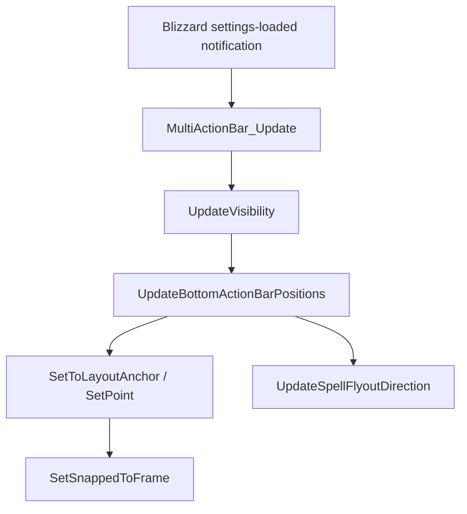

# Action-bar taint incident — 1.24.2

## Reference point

- Release: **v1.24.2**; correction introduced in commit `b4ace3ea35` (`Config/Native.lua`).
- Investigated client: **WoW Forever 1.60.1.71037**, exported UI source commit `734f065329cff4992835b01a84f210a297db91b6`.
- Status: the unsafe registration path is corrected. Two retained post-fix live captures showed clean monitored startup state and zero blocked actions after the user's gameplay test. This confirms the tested path, not every possible future taint source or Retail runtime behavior.
- Canonical implementation and API-source links: [Shared Native Controls](ARCHITECTURE.md#shared-native-controls) and [Opt-in taint diagnostics](ARCHITECTURE.md#opt-in-taint-diagnostics). Reproduction and test commands belong in [Testing](TESTING.md#bounded-taint-capture).

## Symptoms and observations

The user intermittently received `ADDON_ACTION_BLOCKED` naming MathWroQOL and `ActionButton7:SetAttribute()` or `ActionButton10:SetAttribute()`. Blizzard's stacks stopped in `UpdatePingAttributes` or `UpdatePressAndHoldAction`, reached through `UpdateAction` and `ACTIONBAR_SLOT_CHANGED`. Another failure named `MainActionBar:SetPointBase()` when opening the spellbook.

These stacks identified the blocked operation, not the original contaminating write. A secure operation can become blocked long after an earlier addon callback introduced taint.

The user reported that the issue predated enabling native nudging and occurred without opening either Edit Mode or EllesmereUI Unlock Mode. It also recurred with automatic food/water macro updates disabled. Neither interacting with nudge controls nor automatic macro rewriting was necessary to reproduce this incident.

The first local investigation inspected Retail's stale log; the active client and fresh capture were under `_forever_`. The addon folder there resolves to the same working tree as the Retail checkout. Always identify the active client's log and SavedVariables paths before interpreting a missing or stale record.

## Evidence from bounded captures

All times below are local capture timestamps on **2026-11-23**, on Forever build **71037**.

| Capture | Monitored startup state | Blocked events recorded | Context |
|---|---|---:|---|
| 17:44:14, before fix | Clean baseline; snap/flyout fields became MathWroQOL-tainted at elapsed zero | 525 | First observation ran through Blizzard's settings-loaded refresh |
| 18:06:37, before fix | Same startup transition; sampled native visibility-setting fields stayed clean | 25 | First blocked action appeared about 49.228 seconds after capture start |
| 18:18:52, before fix | Same startup transition; broader sampled native layout metadata did not expose an earlier MathWroQOL-owned field | 0 | Startup-only capture; no combat error was required to observe contamination |
| 18:29:47, after fix | Monitored fields remained secure/unset after the settings-loaded refresh; no taint probe fired | 0 | Retained post-fix session |
| 18:36:23, after fix | Monitored fields remained secure/unset after the settings-loaded refresh; no taint probe fired | 0 | Latest capture after the user tested and logged out |

Counts are matching blocked/forbidden-action events observed by the diagnostic, not unique bugs or displayed error popups. A zero count without combat did **not** mean the pre-fix startup state was clean. `secure-or-unset` is the API's distinction: it does not certify that a field exists or that unmonitored nested data is clean.

The first producer observations consistently followed:

The watched `snappedToFrame` and `flyoutDirection` fields were clean at the initial checkpoint and MathWroQOL-tainted at these first observations. Later action-button refreshes exposed the combat restriction. The post-hook stacks are first observed method calls, not universal proof that each hooked method itself originated the taint.

## Source-confirmed unsafe boundary

MathWroQOL registered callable defaults for the selected buff's enable flag and color. Those options are assembled at startup even when their provider-dependent controls are unavailable or the feature is disabled; the user did not need to open Settings.

In the inspected Blizzard source:

1. `Settings.RegisterProxySetting` passes the default through the inbound settings bridge.
2. `ProxySettingMixin:Init` calls `ErrorIfInvalidSettingArguments`.
3. Type validation reaches `GetDefaultValueType` / `GetOrCallDefaultValue`, which invokes a callable default **directly**, without `securecallfunction` isolation.
4. Initialization then continues into the shared settings registry. `CreateSecureMixinCopy` makes a pristine mixin copy; it does not isolate arbitrary callbacks invoked during `Init`.
5. Separately, native Defaults processing **does** call each setting's `SetValueToDefault` through `securecallfunction`.

The direct callback execution during validation is source-confirmed and covered by the regression harness. **[INFERENCE]** That unisolated callback contaminated the shared registration/lookup context, allowing later native action-bar updates to inherit MathWroQOL taint. Engine ownership of non-string registry keys was not measured directly. The clean post-fix startup captures support this mechanism.

## Correction

`Config/Native.lua` now evaluates a callable default in addon context **before** native registration and passes only the resulting scalar value to `Settings.RegisterProxySetting`.

After registration finishes, the helper assigns the callable `GetDefaultValueDerived` only on that addon's setting instance. Native Defaults can therefore still resolve the currently selected profile's boolean or color through its existing isolated per-setting reset path. Shared Blizzard mixins, native settings registry entries, and action-button methods are not rewritten.

The change does not defer the entire addon, disable gameplay features, suppress errors, replace the ping functions, or add a retry loop. It changes where the default-value calculation executes. Registration remains read-only; Defaults still uses the existing setters and provider/combat guards. False boolean defaults must remain false—do not use an `and/or` fallback that returns the callback when it evaluates to false.

`tests/Config_Taint_smoke.lua` first failed because addon defaults executed inside the modeled native validation context. It now passes while checking that registration preserves saved values and that switching profiles still resets the correct boolean and color without modifying another profile. The full Lua smoke suite and syntax checks passed. The harness models the source boundary; it is not an implementation of WoW's taint engine.

## Prevention rules

- Keep callable metadata out of native registration paths whose validation invokes callbacks without isolation. Use the shared `Config/Native.lua` helper; do not reintroduce function-valued defaults directly in page builders.
- Audit the **whole constructor/validation path**, not only the getter/setter wrappers. A secure inbound bridge or secure mixin copy does not make every callback it invokes safe.
- Preserve dynamic behavior at an audited isolated boundary. Do not freeze selected-profile Defaults, discard guards, or mutate shared mixin tables to avoid a taint report.
- Do not treat `securecallfunction` as a magic way to clean existing tainted state. Fix the originating boundary, then start a clean UI session to verify it.
- Do not infer the cause from the final protected call or an addon attribution alone. Inspect clean-to-tainted transitions and caller stacks; distinguish observed facts, user-reported timing, and inferred engine propagation.
- Do not blame Edit Mode interaction or macros without a reproduction that requires them. Keep unrelated toggles unchanged during confirmation; restore normal features after isolation testing rather than shipping disabled functionality as a fix.
- Never retry global `taintLog 4` for this investigation: the user reported a client crash with it. Prefer bounded, opt-in, event-driven capture with no polling, frame-registry enumeration, live aura/action-value scans, or protected-state writes.
- Check the actual client build and use its pinned source export. Shared APIs or a successful Forever test do not prove Retail rendering, provider compatibility, or absence of every future taint issue.

## If the error returns

1. Preserve the first error's full stack, client/build, and what happened since the last UI reload. Do not rerun gameplay steps merely to reconfirm an already reported failure.
2. Load the current addon code, enable `/mqoltaint on`, then `/reload` so capture starts before other feature initializers. Keep global tracing off and other feature settings unchanged.
3. For a startup check, compare `initial`, `firstBarCacheCall.frames`, and `probes.*.frames`. For a combat recurrence, inspect `firstBlocked` as well. A missing visible startup error is expected; contamination can be silent until combat.
4. Run `/mqoltaint off`, log out, then read the active client's `SavedVariables/MathWroQOL.lua` under `MathWroQOLDB.taintDiagnostics`. Inspect both `current` and `previous`. Preserve a local copy before further reloads rotate the two-session retention window.
5. Treat `already-tainted`, `unavailable`, and `truncated` as evidence limits. The first public cache-entry observation is not necessarily the first initialization of a private Blizzard cache.
6. Compare against this release's clean startup result before changing another subsystem. Add a regression for the newly evidenced boundary, then verify a fresh startup and normal combat. Do not silently expand tracing or disable unrelated features.

The diagnostic remains disabled by default. It retains only current/previous sessions, capped stacks, first matching observations/failure, and a repeated-error counter. It cannot prove a clean state outside its sampled boundaries.
